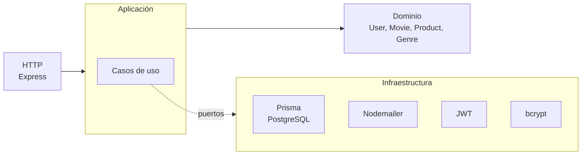

# CineRent · Backend

[](https://github.com/Serberar/cinerent-backend/actions/workflows/ci.yml)

API de **CineRent**, un videoclub online para alquilar películas. Node.js, Express, Prisma y PostgreSQL con **arquitectura hexagonal**, y una prueba que falla si alguna capa rompe la regla de dependencias.

El frontend es [cinerent-frontend](https://github.com/Serberar/cinerent-frontend).

## Arquitectura



- **Dominio** (`src/domain`): entidades y reglas. No importa nada externo.
- **Aplicación** (`src/application`): casos de uso que reciben sus dependencias. Solo conocen el dominio.
- **Infraestructura** (`src/infrastructure`): Express, Prisma, correo, tokens y contraseñas.
- **Composición** (`src/container.js`): el único sitio que une las piezas.

## Funcionalidades

- **Usuarios:** registro con verificación de email, login con JWT, perfil, contraseña y tarjeta.
- **Catálogo:** películas y géneros, destacadas y activación.
- **Alquileres:** alquilar, devolver, historial y devolución automática al vencer.
- **Administración:** usuarios, suspensiones, catálogo y alquileres activos.

## Decisiones de seguridad

- De la tarjeta solo se guardan los cuatro últimos dígitos.
- Los tokens caducan (`JWT_EXPIRES_IN`, 12 horas por defecto) y dejan de valer si se suspende la cuenta.
- Un alquiler ajeno responde igual que uno inexistente.
- El login y el registro tienen límite de intentos, y las respuestas llevan cabeceras de `helmet`.
- El título y el total salen del servidor, no de la petición.
- Los errores internos se registran, pero no se muestran al cliente.

## Arrancar

Con Docker, en un clon limpio:

```bash
cp .env.example .env
docker compose up -d --build      # PostgreSQL y la API en http://localhost:4000
docker compose exec api node prisma/seed.js
```

Para desarrollar con recarga (Node.js 22), con solo la base de datos en Docker:

```bash
docker compose up -d postgres
npm install
npm run prisma:generate && npm run prisma:migrate:deploy && npm run seed
npm run dev
```

El seed carga un catálogo ficticio. Si defines `ADMIN_EMAIL` y `ADMIN_PASSWORD` en `.env`, crea también el administrador.

## Pruebas

```bash
npm test                    # unitarias, arquitectura y HTTP, sin base de datos
npm run test:integration    # repositorios contra PostgreSQL (usa y VACÍA la base de DATABASE_URL)
```

La CI ejecuta las dos en cada push sobre un PostgreSQL limpio, y además levanta el proyecto con Docker y comprueba que responde con datos.

## Rutas

| Prefijo | Qué cubre |
|---|---|
| `/api/user` | Registro, login, verificación y perfil |
| `/api/movie`, `/api/genre` | Catálogo |
| `/api/product` | Alquileres |
| `/api/admin` | Administración |
| `/health` | Comprobación de salud |

## Licencia

Publicado con licencia [MIT](LICENSE).

## Autor

Sergio Bernabé
